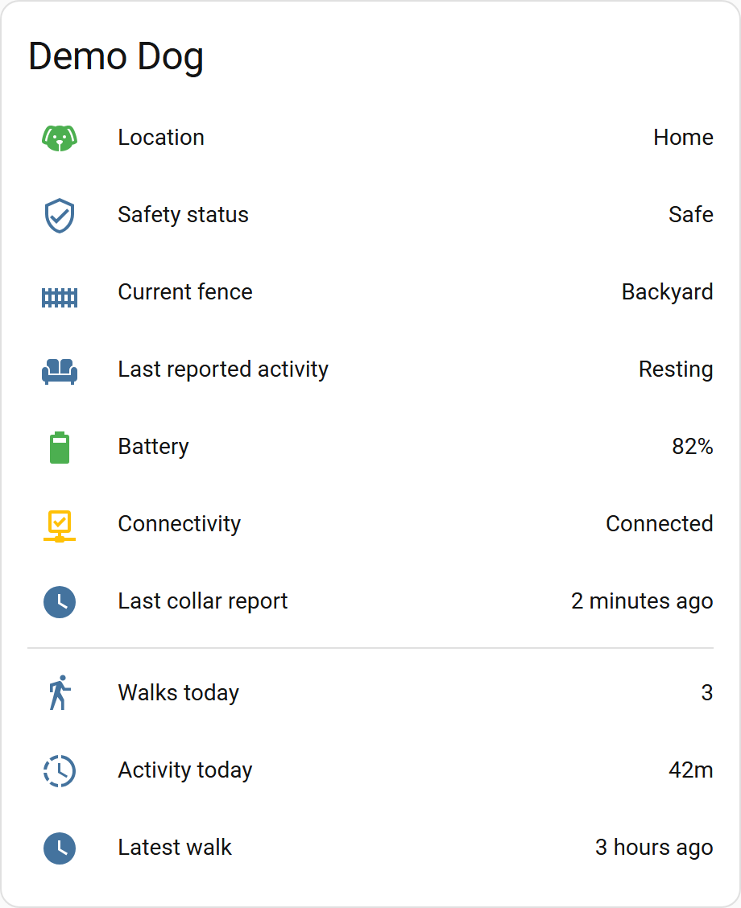

# Halo Collar for Home Assistant

<p align="center">
  
</p>

[](https://github.com/itsreverence/ha-halo-collar/releases)
[](https://github.com/hacs/default)
[](https://github.com/itsreverence/ha-halo-collar/actions/workflows/validate.yml)

A Home Assistant custom integration for [Halo Collar](https://www.halocollar.com/) location, battery, connectivity, activity, and fence telemetry. Physical controls are opt-in.

> [!IMPORTANT]
> This is an **unofficial** integration. It is not affiliated with, endorsed by, or supported by Halo Collar / Protect Animals With Satellites, LLC. It talks to Halo's private mobile/cloud API, which may change or break at any time. Use at your own risk.

<p align="center">
  <picture>
    <source media="(prefers-color-scheme: dark)" srcset="docs/assets/screenshots/dashboard-card-dark.png">
    
  </picture>
</p>
<p align="center"><sub>An example dashboard card built from this integration's entities, using synthetic demo data.</sub></p>

## Entities

The integration is **telemetry-only by default**. Each collar has:

- A device tracker with provider GPS coordinates. When Halo reports indoors and Wi-Fi, the tracker reports `home`. This does not verify the Wi-Fi network or physical home location, and it does not replace the map coordinates.
- Battery, connectivity, location, fence, calibration, firmware, and diagnostic-status sensors, plus a **Fence breach event** for automations.
- Provider daily/current-period activity metrics and cloud-polled active-walk duration and distance. Durations display in minutes on new installs. Existing installs keep seconds until you pick another unit in the entity's settings. Goal attributes keep Halo's units (seconds or meters), and `progress_percent` is unitless.
- **Last reported activity** shows Halo's latest classification, such as walking or resting. Activity, safety status, current fence, active walk, and fence breach read unknown while **Connectivity** is off, so an old report never looks current. Battery, location, and other readings keep their last values.
- Recent-walk sensors for the newest matching completed walk in the first 30 records returned by Halo. These are supplemental history, not live tracking. Unknown can mean no valid match in that window or an optional history request failure.

The activity labels come from the Halo app. A live response confirmed the field and its integer codes. The label meanings have not been checked against observed behavior yet.

An account-level **Subscription** sensor summarizes subscription limits. Optional physical controls are described under [Options](#options). See [Architecture](docs/ARCHITECTURE.md#platforms) for detailed entity coverage.

## Requirements

- Home Assistant 2024.12 or newer.
- A Halo account with an active Pack Membership Plan and at least one paired collar (the same email/password you use in the Halo mobile app).

## Installation

[](https://my.home-assistant.io/redirect/hacs_repository/?owner=itsreverence&repository=ha-halo-collar&category=integration)
[](https://my.home-assistant.io/redirect/config_flow_start/?domain=halo_collar)

### Marketplace (Home Assistant 2026.11 and newer)

In Home Assistant 2026.11, HACS became the built-in [Marketplace](https://www.home-assistant.io/integrations/marketplace/). The Marketplace is available to administrators only. The HACS button above still works and opens the repository in the Marketplace.

1. Go to **Settings > Marketplace** and accept the warning shown on first use.
2. Search for **Halo Collar** and open its page.
3. Select **Install**, check the version, then select **Install** again.
4. Restart Home Assistant when asked, then follow [Configuration](#configuration). A Repairs entry reminds you when a restart is needed and can restart Home Assistant for you.

If you installed Halo Collar through HACS before updating, the Marketplace migrates it automatically when Home Assistant starts after the update.

### HACS (Home Assistant 2024.12 to 2026.10)

Halo Collar is included in the [HACS default catalog](https://github.com/hacs/default). You do not need to add a custom repository.

1. Open HACS and search for **Halo Collar**.
2. Open its repository page and select **Download**.
3. Restart Home Assistant, then follow [Configuration](#configuration).

### Manual

1. Copy `custom_components/halo_collar` into your Home Assistant `config/custom_components/` directory.
2. Restart Home Assistant, then follow [Configuration](#configuration).

## Configuration

1. Go to **Settings → Devices & Services → Add Integration**.
2. Search for **Halo Collar**.
3. Enter the **email** and **password** for your Halo account.
4. Submit. The integration signs in, discovers your collars, and creates the entities.

The advanced OAuth client fields use the official app's defaults. You can override them during initial setup. Reauthentication and options cannot replace saved OAuth settings. For an existing entry with authentication trouble, follow [Recover authentication](SUPPORT.md#recover-authentication).

Home Assistant stores tokens, expiry, normalized email, and OAuth client settings, but never your password. It refreshes access tokens automatically and prompts for same-account reauthentication when needed. See [Authentication](docs/ARCHITECTURE.md#authentication) for the password-grant flow and persistence details.

### Confirm it is working

Leave controls off while you check telemetry. Open the collar device under **Settings > Devices & services > Halo Collar**. Check **Battery**, **Connectivity**, **Last telemetry**, **Connection type**, **Location status**, and the device tracker. Compare important values with the official Halo app before using them in automations.

A successful cloud poll can return an old collar report. **Connectivity** measures report age, not a live connection test. Missing optional values can be **unknown** while other telemetry works. A failed required refresh makes telemetry entities **unavailable** until a successful refresh. See [telemetry troubleshooting](SUPPORT.md#telemetry-stale-unknown-or-unavailable).

### Add a starter dashboard

In your dashboard's editor, add an Entities card and select the sensors above through Home Assistant's entity picker. Add **Fences enabled**, **Fence state synchronized**, and **Active walk** if useful. An optional Map card can show the tracker, with the coordinate caveat under [Entities](#entities). Choose the actual entities from your installation.

### Options

Open **Configure** on the integration under **Settings > Devices & services**.

| Option | Default and behavior |
| --- | --- |
| **Update interval (seconds)** | 300, range 60-3600. Polls Halo's cloud without requesting a new collar report. Shorter intervals increase cloud requests. |
| **Collar report age limit (seconds)** | 900, range 120-86400. Connectivity reflects report age when Home Assistant next updates the state, not at an exact expiry time. |
| **Enable fail-safe fence controls** | Off. Adds **Enable fences**, which can restore fence enforcement but cannot disable it. |
| **Allow fences to be disabled (requires fence controls)** | Off. Also requires **Enable fail-safe fence controls**. Adds **Fence mode**, which can disable containment, including through automations. Active or unknown walks block fence-off. |
| **Enable Find collar sound and light** | Off. Adds **Find collar (sound and light)** to request a sound and light command. It may confuse a pet wearing the collar. It requires fresh exact mapping, subscription entitlement, and no active or unknown walk. Every attempted dispatch starts a 60-second cooldown, including failed or ambiguous outcomes. Provider acceptance does not verify physical execution. |
| **Enable Recall whistle** | Off. Adds a **Recall whistle** button for each dog that wears a Halo collar. Turning it on first asks you to register Home Assistant with Halo, a permanent account change. See [Recall whistle](#recall-whistle). |

Controls require telemetry no older than the shorter of **Collar report age limit** and 900 seconds. Fence changes require synchronized reported-state confirmation. Commands are sent at most once and are never replayed after an ambiguous result.

Each opted-in action adds a status sensor under **Diagnostic** on the collar's device page. Check **Enable fences status**, **Disable fences status**, or **Find collar status** for a cached reason such as unknown walk state or cooldown. These sensors stay readable during cloud failures. **Ready to try** means cached data shows no blocker. The action still fetches and validates fresh state and can be rejected.

Changing a control option reloads the integration. Revoked controls and their matching status sensors may remain in the entity registry as unavailable. Revoked controls cannot dispatch commands. See [control troubleshooting](SUPPORT.md#control-missing-unavailable-or-rejected) and the [control transaction design](docs/ARCHITECTURE.md#control-transactions).

### Recall whistle

The Recall whistle button plays the Recall whistle you trained your dog to come to, so an automation can call your dogs in when the dog door opens, a storm is coming, or a camera hears coyotes. The Halo app cannot automate this. **Find collar** plays a different sound.

It uses Halo's unofficial private API. Halo may change or block it at any time.

- **Whistle only.** The integration sends only Halo's `returnwhistle` command. It cannot send warnings, static, or any other correction.
- **Permanent registration.** Halo accepts this command only from a registered mobile device. Turning the option on shows a confirmation step. Confirming sends one request that adds Home Assistant to your Halo account as a device. Halo offers no way to remove it, and removing this integration does not remove it. Turning the option off and on again reuses the same registration.
- **Success means Halo accepted the command.** Halo reports no confirmation that the collar played it. Check on your dog.
- **Each press is checked again.** A press rereads Halo and is refused on stale or ambiguous pet and collar state, an active or unknown walk, collar firmware without numbered commands, missing Halo server time, and the cooldown. Each command expires at most 30 seconds after Halo's clock, sooner if Halo's own window is shorter, and is never retried.
- **60-second cooldown per collar.** Every attempted send starts it, including failed or ambiguous ones. After Home Assistant restarts, presses wait 60 seconds.

Use the button in an automation. Pick your dog's button with the entity picker; the entity ID below is an example.

```yaml
actions:
  - action: button.press
    target:
      entity_id: button.example_dog_recall_whistle
```

Target the button, not the collar's device. A device target presses whichever dog wears that collar, as of Halo's latest report.

The button stays pressable even when a press would be refused, so a refusal shows as an error in the automation trace instead of being skipped silently. Each dog's **Recall whistle status** sensor under **Diagnostic** shows the cached reason a press would be refused, or **Ready to try**. A dog keeps its button while Halo reports no collar for it; a press then fails with that reason.

One case is silent. While the integration itself is not loaded, for example while Home Assistant retries setup after Halo was unreachable at startup, Home Assistant has no Recall buttons and skips `button.press` without an error. If an automation must know, add a condition that the button's state is not `unavailable` and notify yourself otherwise.

#### Recall whistle recovery

If Halo's answer to the registration request is lost, Halo may or may not have added the device. The integration never sends a second registration for that entry, and the status shows **Registration needs recovery**. To start over, remove the Halo Collar integration and add it again. This deletes the local Recall state. The new entry starts with Recall off, and turning it on asks you to register again, which can leave an extra device on your Halo account.

If the status shows **Saved Recall state unreadable**, restart Home Assistant. If it persists, remove and add the integration as above. The integration never treats unreadable state as a fresh start, so it does not register again on its own.

## Safety and limitations

- **Telemetry-only by default.** Every physical control requires its own explicit opt-in. Fence creation/editing/deletion, corrections (warnings, static, or anything but the Recall whistle), bind/unbind, and other control endpoints remain intentionally unsupported.
- **The Recall whistle is a physical command.** Use it for recall, not as a test. Its registration is a permanent change to your Halo account.
- **Find collar is a physical command, not a connectivity test.** It requests a sound and light command. Do not invoke it casually while your pet is wearing the collar, and do not automate repeated presses.
- **Fence state is safety-critical.** Treat Home Assistant controls and automations as supplemental conveniences, not a containment authority. Confirm important changes in the official Halo app and physically verify your pet is safe.
- Do not rely on this integration for your pet's containment or safety. The official Halo app and collar are the source of truth. Location, fence, and active-walk state are cloud-polled supplemental telemetry, not real-time containment proof; activity metrics are provider daily/current-period values.
- Because it depends on an undocumented API, functionality may degrade without notice.

## Troubleshooting

- Restart Home Assistant after installing or updating through the Marketplace or HACS.
- Complete [same-account reauthentication](SUPPORT.md#recover-authentication) if Home Assistant prompts for it.
- For a missing control or a rejected action, use the [control troubleshooting table](SUPPORT.md#control-missing-unavailable-or-rejected).
- Compare important location and status values with the official Halo app.
- For bugs, [collect logs and diagnostics](SUPPORT.md#collect-logs-and-diagnostics) and review them before sharing.

See [SUPPORT.md](SUPPORT.md) for support routes, first checks, and sensitive-data guidance.

## Project docs

- [Support](SUPPORT.md)
- [Security policy](SECURITY.md)
- [Contributing](CONTRIBUTING.md)
- [Architecture](docs/ARCHITECTURE.md)
- [Release process](docs/RELEASING.md)
- [MIT License](LICENSE)
